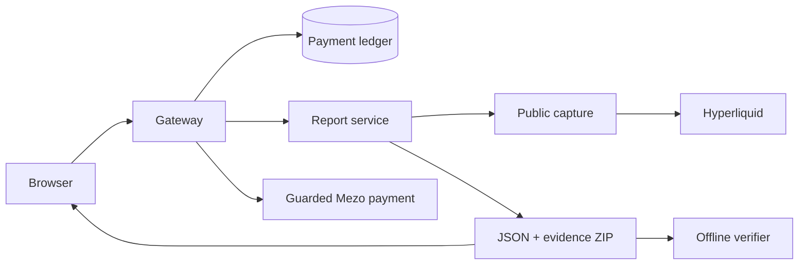

<div align="center">

# Liqvera

### Market reports you can verify.

**Turn a BTC market snapshot into a report you can inspect, download and reproduce.**

[Open the demo](https://liqvera.site) · [Documentation](docs/README.md) · [Security](SECURITY.md) · [Releases](https://github.com/Dimkox/liqvera/releases)

Built for [Mezo](https://mezo.org/) · [The Mezo Buildathon](https://app.akindo.io/wave-hacks/OVOO0gdrVU8379D10)

</div>

---

## See the depth behind the price

A headline price does not tell you how much an order would fill, or at what average price. Liqvera takes a public Hyperliquid BTC perpetual order-book snapshot and calculates a hypothetical buy or sell using exact arithmetic.

Each report includes its inputs, calculations and evidence. Download the JSON for inspection, keep the ZIP for reproduction, and verify the result offline.

**Try it without a wallet:** open [liqvera.site](https://liqvera.site), select **Show latest live report**, then download the evidence ZIP. The preview is a sealed public-market capture with its timestamp displayed; opening it does not request a new snapshot or make a payment.

## What you get

| Capability | Result |
| --- | --- |
| Market-depth analysis | Filled quantity, notional, VWAP, worst price and price impact for a hypothetical order |
| Exact calculations | Decimal and rational arithmetic with explicit display rounding |
| Inspectable evidence | Source metadata, sealed inputs and SHA-256 bindings |
| Portable reports | Downloadable JSON and a self-contained evidence ZIP |
| Offline verification | Integrity checks and recalculation without network access |
| Wallet integration | A browser flow for Mezo wallets and MUSD report access through x402 |

Reports describe the observed snapshot. They do not place trades, promise execution, or include fees, funding or net P&L. Hashes establish evidence integrity; they do not independently authenticate an exchange.

## Live service

The public preview, downloads and report-generation services are running. The deployed services produced the October 12, 2026 preview, and its bundle passed offline reproduction. Browser verification confirms that the preview renders and offers the verified ZIP.

The service runs on **Mezo Testnet, chain 31611**, at **0.01 test MUSD per report**. **Wallet checkout is enabled.** Connect a wallet, request a fresh report, review its terms and confirm payment in your wallet. The wallet-free preview remains available.

Public checks verify fresh live-report generation and the exact Testnet payment challenge. A new paid-delivery acceptance on this deployment still requires a buyer signature and verified downloads.

All seven deployed containers passed health checks. The [deployment and security report](docs/security/2026-10-12-testnet.md) identifies their exact images and records dependency scans, fixes and the evidence behind remaining scanner matches.

## Run locally

Requires Python 3.12+, Node.js 22 or 24, npm and Git. Docker with Compose is required for the complete service stack and database integration tests.

```sh
python3 -m venv .venv
.venv/bin/python -m pip install -e '.[dev,audit]'
make verify PYTHON=.venv/bin/python
make liqvera-gateway liqvera-web
npm test --prefix apps/mezo-gateway
npm test --prefix apps/mezo-web
```

Follow the [startup guide](docs/runbooks/startup-shutdown.md) to configure and start the service stack. The isolated fixture profile uses synthetic data and cannot make payments. Database tests require an explicitly disposable database; see [validation](docs/validation.md).

Ordinary wallet checkout uses `LIQVERA_PAYMENT_MODE=merchant` with a fixed recipient and the selected Mezo network; see the [Testnet demo guide](docs/runbooks/testnet-demo.md). The default grant mode retains the bounded operator workflow.

For a smaller local fixture demonstration:

```sh
make mvp PYTHON=.venv/bin/python
make mvp-web PYTHON=.venv/bin/python
```

This prototype labels its output **SIMULATED / UNVERIFIED** and has no payment path.

## Verify a report offline

Build the Python packages from a clean checkout, install the verifier, then check a downloaded canonical evidence bundle:

```sh
make liqvera-python PYTHON=.venv/bin/python
python3 -m venv /tmp/liqvera-reader
/tmp/liqvera-reader/bin/pip install --no-index \
  --find-links=dist/liqvera/python liqvera-evidence-report==0.2.0
/tmp/liqvera-reader/bin/liqvera-evidence-verify /path/to/evidence.zip \
  --report-sha256 TRUSTED_REPORT_SHA256
```

Obtain the report digest from an independently trusted receipt or published preview. A successful result is `INTEGRITY_REPRODUCED`. The small fixture prototype uses a different bundle format; use the canonical service bundle with this verifier.

## How it works



The browser and gateway use TypeScript. Python packages handle public capture, exact calculations and evidence verification. PostgreSQL stores durable payment and delivery state. Docker Compose runs the isolated services behind Caddy and nginx.

Capture has no wallet or exchange trading credentials. Payment validation binds the payer, recipient, network, token, amount and report hashes. Ambiguous settlement outcomes are reconciled without blindly submitting another payment.

## Explore the project

| Guide | Contents |
| --- | --- |
| [Specification](docs/specification.md) | Product behavior and boundaries |
| [Architecture](docs/architecture.md) | Components, data flow and isolation |
| [Deployment](docs/deployment.md) | Service setup, operations and recovery |
| [Testnet demo](docs/runbooks/testnet-demo.md) | Wallet checkout, test tokens and standalone deployment |
| [Mainnet configuration](docs/mainnet.md) | Optional network selection and ledger separation |
| [Validation](docs/validation.md) | Tests, builds and verification commands |
| [Security](SECURITY.md) | Trust boundaries and vulnerability reporting |
| [Buildathon materials](docs/competition/submission.md) | Project presentation and submission draft |
