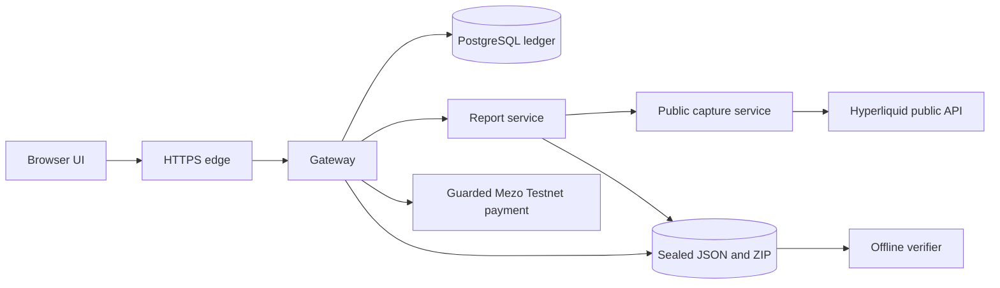

# Liqvera

**Market reports you can verify.**

Liqvera turns public Hyperliquid BTC perpetual order-book snapshots into exact, reproducible market reports. The application includes a browser UI, a PostgreSQL-backed gateway, isolated capture and report services, downloadable evidence bundles, and an offline verifier. Access payments use test MUSD on Mezo Testnet (chain 31611) through a guarded x402 integration.

Built for [MEZO](https://mezo.org/) and [The Mezo Buildathon](https://app.akindo.io/wave-hacks/OVOO0gdrVU8379D10). [Repository](https://github.com/Dimkox/liqvera) · [Published releases](https://github.com/Dimkox/liqvera/releases) · [Demo](https://liqvera.site).

## Current state

The latest published source release is **v0.0.5**. Current source migrates the complete application to Liqvera component identifiers at **0.2.0**; this breaking migration is not yet packaged as a tagged release. The separately published Linux operator is **v0.0.2**. See [migration and recovery](docs/migration.md) before using existing state.

The public application runs the updated Liqvera stack: all seven containers were replaced with audited images on 2026-10-12. The landing page, API health and public preview are available. A new live-public report was generated by the deployed services and reproduced by the offline verifier without network access. The downloadable preview contains that report and its pinned evidence hashes.

New payments remain unavailable until valid external payment authority is supplied; `/readyz` reports this blocker. Historical testnet settlements demonstrated paid JSON/ZIP delivery, but do not establish current paid availability. See the [production deployment and security audit](docs/security/2026-10-12-production.md) for exact images, fresh advisory checks, backport evidence and recovery references. The [local validation report](docs/security/2026-10-12-remediation.md) records 1,167 passing tests plus 85 subtests; the gateway follow-up passed 61 tests with a disposable database.

The historical acceptance aggregate is 9 PASS and 21 NOT_RUN, not an overall acceptance PASS. A new local test run does not turn unexecuted live cases into passing cases.

## Run locally

Requirements: Python 3.12+, Node.js 22 or 24, npm, and Git. Docker with Compose is needed for service and database integration.

```sh
python3 -m venv .venv
.venv/bin/python -m pip install -e '.[dev,audit]'
make verify PYTHON=.venv/bin/python
make liqvera-gateway liqvera-web
npm test --prefix apps/mezo-gateway
npm test --prefix apps/mezo-web
```

Gateway database tests require an explicitly disposable loopback PostgreSQL database. Without one, those tests are reported as skipped. [Validation instructions](docs/validation.md) explain how to run the additional checks.

## F3 MVP prototype

`make mvp PYTHON=.venv/bin/python` runs the small fixture prototype and writes `.mvp/output/report.json` and `.mvp/output/evidence.zip`. Its output is explicitly **SIMULATED / UNVERIFIED**. Payments and live verification are not implemented **in this prototype**; the full application has separate canonical report and payment paths. `make mvp-web PYTHON=.venv/bin/python` starts its loopback demo UI.

The canonical report package provides `liqvera-evidence-build`, `liqvera-evidence-verify`, and `liqvera-evidence-report-service`. Install built wheels to use these CLIs. The verifier checks bundle integrity and recalculates results without network access; an optional trusted report digest binds the result to an independently obtained receipt.

```sh
make liqvera-python PYTHON=.venv/bin/python
python3 -m venv /tmp/liqvera-reader
/tmp/liqvera-reader/bin/pip install --no-index --find-links=dist/liqvera/python liqvera-evidence-report==0.2.0
/tmp/liqvera-reader/bin/liqvera-evidence-verify /path/to/evidence.zip --report-sha256 TRUSTED_DIGEST
```

Artifact builds require a clean source checkout and bind output to its exact commit. The prototype ZIP and canonical service ZIP are different formats; use the matching verifier.

## How the pieces connect



| Path | Responsibility |
| --- | --- |
| `apps/mezo-web` | Wallet discovery, quote/report flow, historical preview and downloads |
| `apps/mezo-gateway` | HTTP API, payment state, entitlement, PostgreSQL migrations and workers |
| `packages/contracts` | Exact arithmetic and shared market/evidence types |
| `packages/public-capture` | Credential-free capture and immutable input publication |
| `packages/readonly-analyzer` | Frozen-input validation and exact depth calculations |
| `packages/evidence-report` | Canonical reports, bundles, service and offline verification |
| `packages/mezo-protocol` | Pinned official Mezo protocol metadata and upstream notices |
| `schemas/mezo-evidence/v1` | OpenAPI, JSON schemas, state graphs and contract vectors |
| `deploy/mezo-evidence` | Isolated fixture/live-public Compose profiles |
| `installer` | Verified Linux installation and lifecycle contracts |
| `tools/mezo_acceptance` | Evidence-bound acceptance producer and verifier |

## Boundaries

Reports describe a hypothetical sweep of an observed snapshot. They do not include fees, funding, net P&L, or a promise of execution. Hashes establish internal integrity, not independent exchange authenticity. Public-data failure must not fall back to fixture data. There is no live exchange trading authority.

Payment startup is fail-closed. A valid external authority, bound payer/recipient, exact testnet asset/amount, sponsored authorization and canonical finality are required. An unknown submission is confirm-only, never a reason to retry settlement. Historical bundles remain byte-identical; their old identifiers are isolated compatibility data, not active package names.

[Documentation](docs/README.md) · [Architecture](docs/architecture.md) · [Specification](docs/specification.md) · [Deployment](docs/deployment.md) · [Security](SECURITY.md) · [Roadmap](docs/ROADMAP.md)
